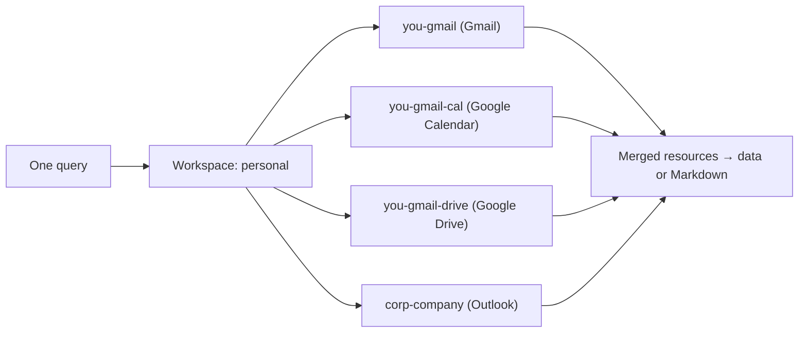

# Concepts

Five ideas explain how iobox works. Everything in the MCP, CLI, and SDK docs builds on them.



## Workspace

A **workspace** (also called a *space*) is a named collection of accounts — for example `personal` or `work`. It's the thing you point queries at, rather than at an individual provider.

- Workspaces are stored as TOML files at `~/.iobox/workspaces/NAME.toml`.
- One workspace is **active** at a time (recorded in `~/.iobox/active_space`). Commands and tools use it unless you name another.
- The first workspace you create becomes active automatically.

## Service session

A **service session** is one account added to a workspace: a service (`google` or `o365`), an account email, the scopes you've enabled, and a mode.

```toml
[workspace]
name = "personal"

[[services]]
number = 1
id = "google-yougmailcom"
slug = "you-gmail"
service = "google"
account = "you@gmail.com"
scopes = ["email", "calendar", "drive"]
mode = "readonly"
```

Each service session is authenticated once with OAuth when you add it. Tokens are stored per account under `~/.iobox/tokens/ACCOUNT/` and are shared by every service enabled for that account.

| Scope | Google | Microsoft 365 |
|---|---|---|
| `email` | Gmail | Outlook |
| `calendar` | Google Calendar | Outlook Calendar |
| `drive` | Google Drive | OneDrive *(not yet available via `space add`)* |

## Slot

When a workspace loads, each enabled scope of each service session becomes a **provider slot**: a named provider instance. Slot names are derived from the account's *slug* (local part + first part of the domain):

| Account | Email slot | Calendar slot | Files slot |
|---|---|---|---|
| `you@gmail.com` | `you-gmail` | `you-gmail-cal` | `you-gmail-drive` |
| `corp@company.com` | `corp-company` | `corp-company-cal` | `corp-company-drive` |

Queries **fan out** across every slot of the relevant type by default. Pass a slot name (`--provider` in the CLI, `provider=` in MCP tools and the SDK) to target one account.

## Resource

Everything iobox returns is a **resource**: an email, an event, or a file. Resources from different providers share a common shape — `id`, `provider_id`, `resource_type`, `title`, `created_at`, `modified_at`, `url` — plus type-specific fields like `start`/`end` for events or `mime_type` for files. See [SDK types](../sdk/types.md) for the full definitions.

Any resource can be exported to Markdown with YAML frontmatter. See [Output format](../reference/output-format.md).

## Access modes

iobox has two layers of protection against unintended changes.

**1. Per-account mode** — set when you add a service session. `--read` requests read-only OAuth scopes; omitting it requests read-write scopes. A read-only token *cannot* modify anything, regardless of what tool or command is used.

**2. Process access mode** — set with `--mode` (CLI) or `IOBOX_MODE` (CLI and MCP). It controls which commands and tools are available at all:

| Mode | Allows | Example operations |
|---|---|---|
| `readonly` | Search, read, and save to disk | search, get, save, list |
| `standard` *(default)* | Reversible writes | drafts, labels, create/update events, upload files |
| `dangerous` | Outbound and destructive actions | send, forward, trash, delete events |

Modes are additive: `standard` includes everything in `readonly`, and `dangerous` includes everything in `standard`.

!!! note
    The two layers are independent: an operation must be allowed by **both** the process mode and the account's token. In the CLI, the process mode gates email commands and the `events` / `files` subcommands the same way as the MCP tools (e.g. `events delete` needs `dangerous`; `files upload` needs `standard`); `space` and `workspace` are allowed in every mode. Note that `standard` mode also permits `draft-send` / `send_gmail_draft`, which sends mail, and `files delete` / `delete_file`. For a hard guarantee, add accounts with `--read`.

!!! tip
    For an AI assistant, start with `IOBOX_MODE=readonly` and add accounts with `--read`. Widen access deliberately once you trust the setup.

## Where things live

```
~/.iobox/
  active_space            # name of the active workspace
  credentials.json        # Google OAuth client (see Connect Google)
  workspaces/
    personal.toml
    work.toml
  tokens/
    you@gmail.com/
      token_readonly.json
      token_standard.json
    corp@company.com/
      microsoft_token.txt
```
