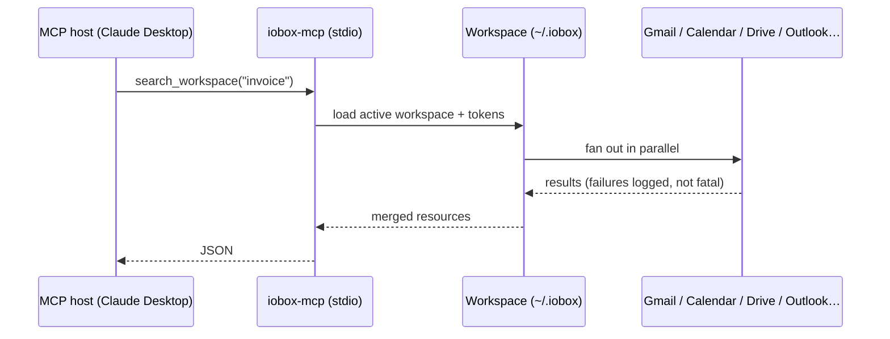

# MCP Server

iobox ships a [Model Context Protocol](https://modelcontextprotocol.io/) server, `iobox-mcp`, that gives AI assistants — Claude Desktop, Claude Code, Cursor, VS Code, and any other MCP host — direct access to your workspace: email, calendar events, and files across every account you've configured.

## Why use it

- **One connector, every account.** A single server covers personal and work Gmail, Outlook, both calendars, and both drives. The assistant can search them all in one tool call.
- **Your own credentials.** Data flows from Google/Microsoft to your machine to your MCP host. There's no hosted middleman.
- **Guard-railed.** `IOBOX_MODE` decides which tools exist at all. In `readonly` mode, there is no tool that can send, modify, or delete anything.
- **Built for LLMs.** Bodies can be returned as Markdown, plain text, or omitted; batch tools (`get_emails`) let an assistant triage many messages in one call without blowing its context.

## How it works



The host launches `iobox-mcp` as a subprocess and talks to it over stdio. The server loads the active workspace and uses the tokens the CLI created — it never runs an OAuth flow itself.

## Set up Claude Desktop

### 1. Install with the MCP extra

```bash
pip install 'iobox[mcp]'
which iobox-mcp      # note this path
```

### 2. Configure a workspace from the terminal

OAuth needs a browser, which the MCP subprocess can't open — so add accounts with the CLI first:

```bash
iobox space create personal
iobox space add google you@gmail.com --email --calendar --drive --read
iobox space status
```

See [Connect Google](../get-started/connect-google.md) if you haven't created an OAuth client yet.

### 3. Add the server to Claude Desktop

Open **Claude Desktop → Settings → Developer → Edit Config** and add:

```json
{
  "mcpServers": {
    "iobox": {
      "command": "/full/path/to/iobox-mcp",
      "env": {
        "IOBOX_MODE": "readonly"
      }
    }
  }
}
```

Use the absolute path from `which iobox-mcp` — Claude Desktop doesn't inherit your shell's `PATH`.

### 4. Restart and try it

Quit Claude Desktop fully (**Cmd-Q** on macOS) and relaunch. Then ask:

- *"List the provider slots in my iobox workspace."*
- *"What's on my calendar next week?"*
- *"Find emails from my accountant in the last 30 days and summarise what they need from me."*

### Claude Code

```bash
claude mcp add iobox --env IOBOX_MODE=readonly -- iobox-mcp
```

Other hosts (Cursor, VS Code, …) take the same `command` + `env` shape in their own MCP config files.

## Next

- [Configuration](configuration.md) — access modes and environment variables
- [Multi-account](multi-account.md) — fan-out vs targeting a single account
- [Tool reference](tools.md) — every tool and its parameters
- [Troubleshooting](troubleshooting.md)
