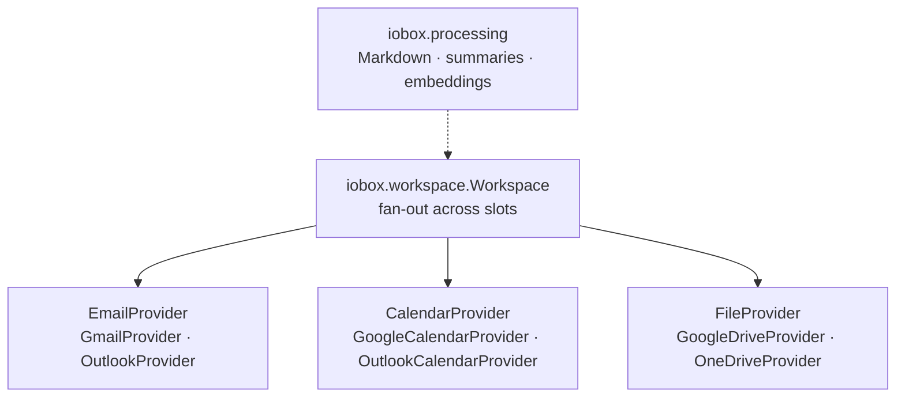

# Python SDK

Everything the CLI and MCP server do is built on a Python package you can import directly. Use it to build your own agents, scheduled jobs, or data pipelines over email, calendar, and files — without writing a separate integration for each provider.

!!! note "Pre-1.0 API"
    iobox is below 1.0. The modules documented here are stable in practice, but names may still change between minor versions. Pin your version.

## When to use the SDK

| Use the SDK when… | Use something else when… |
|---|---|
| You're writing Python and want typed, in-process access | You want an AI assistant to use iobox → [MCP server](../mcp/index.md) |
| You need to post-process results (filter, join, summarise, embed) | You just want files on disk → [CLI](../cli/index.md) `save` |
| You're building an agent with your own tool definitions | You're scripting from shell → [CLI](../cli/index.md) |

## Layers



| Module | Use it for |
|---|---|
| [`iobox.workspace`](workspace.md) | Load a configured workspace and query every account at once |
| [`iobox.providers`](providers.md) | Talk to a single provider directly; implement your own |
| [`iobox.providers.base`](types.md) | Resource types (`Email`, `Event`, `File`) and query types |
| [`iobox.processing`](processing.md) | Markdown export, Claude summaries, semantic search |
| `iobox.space_config` | Read and write workspace TOML configs |

## Install

```bash
pip install iobox                  # Google
pip install 'iobox[outlook]'       # + Microsoft 365
pip install 'iobox[ai,semantic]'   # + summaries and embeddings
```

## First script

Configure a workspace with the CLI first ([Quick Start](../get-started/quickstart.md)) — the SDK reuses its config and tokens.

```python
from iobox.space_config import get_active_space, load_space
from iobox.workspace import Workspace

ws = Workspace.from_config(load_space(get_active_space()))

for r in ws.search("invoice", max_results_per_type=5):
    print(r["resource_type"], r["provider_id"], r["created_at"], r["title"])
```

`Workspace.from_config` builds providers lazily — no network calls or OAuth happen until the first query.

## Authentication in code

The SDK never needs to open a browser if tokens already exist. Run `iobox space add …` once interactively; after that, scripts, cron jobs, and agents can load the workspace headlessly. Tokens refresh automatically.

If a token is missing, the first API call starts an interactive OAuth flow — avoid this in unattended environments by checking `iobox space status` first.

## Next

- [Workspace](workspace.md) — the fan-out API
- [Providers](providers.md) — single-provider access and writes
- [Types](types.md) — what comes back
- [Processing](processing.md) — Markdown, summaries, embeddings
